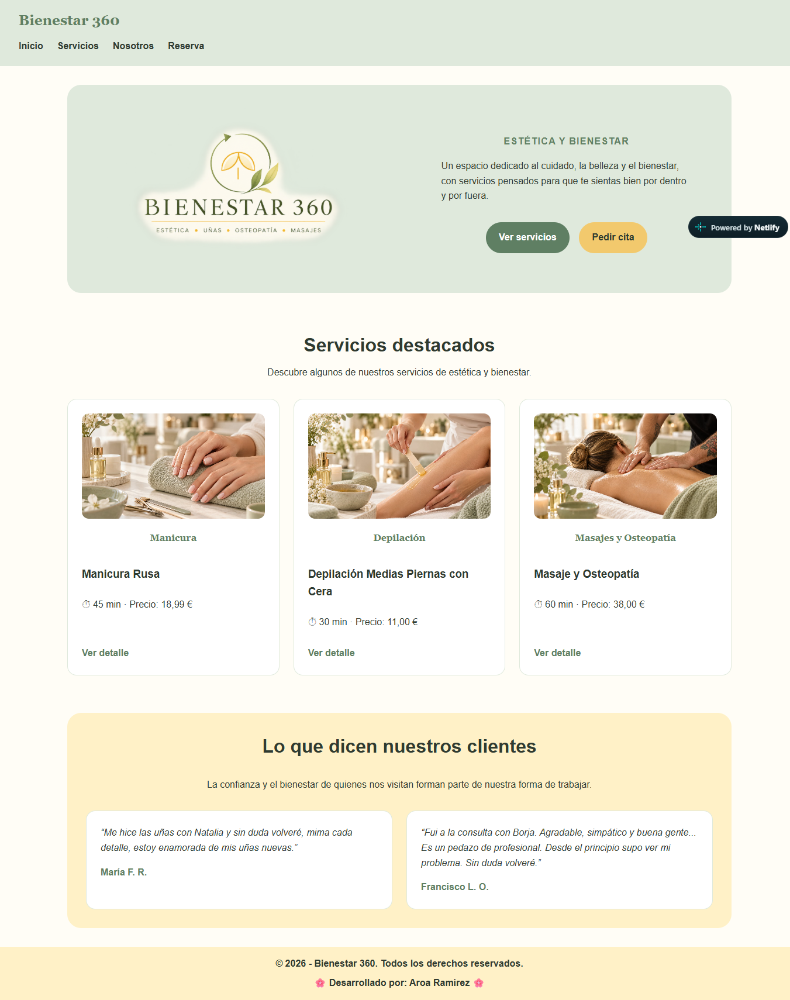
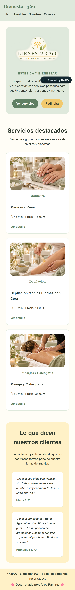

# Diseño — Bienestar 360

## 1. Objetivo del documento

Este documento recoge las principales decisiones de diseño utilizadas en Bienestar 360.

Incluye:

- estructura del sitio,
- vista de escritorio,
- vista móvil,
- paleta de colores,
- tipografías,
- componentes y elementos repetidos,
- comportamiento responsive.

El objetivo es mostrar de forma sencilla cómo se ha organizado visualmente la aplicación.

## 2. Estructura del sitio

Bienestar 360 se organiza en cinco páginas principales:

- `/` — Inicio: presenta el centro, los servicios destacados y testimonios de clientes.
- `/servicios` — Servicios: muestra el catálogo de servicios disponibles.
- `/servicios/[id]` — Detalle de servicio: muestra la información de un servicio concreto.
- `/nosotros` — Nosotros: presenta el centro y el equipo.
- `/reserva` — Reserva: permite enviar una solicitud de información o reserva.

Todas las páginas comparten la cabecera, la navegación principal y el footer.

## 3. Wireframe — escritorio

### Vista de referencia: Inicio

```text
┌──────────────────────────────────────────────────────────────┐
│ Bienestar 360        Inicio | Servicios | Nosotros | Reserva │
└──────────────────────────────────────────────────────────────┘

┌──────────────────────────────────────────────────────────────┐
│                                                              │
│          LOGO              ESTÉTICA Y BIENESTAR              │
│                            Texto de presentación              │
│                            [Ver servicios] [Pedir cita]       │
│                                                              │
└──────────────────────────────────────────────────────────────┘

┌──────────────────────────────────────────────────────────────┐
│                    SERVICIOS DESTACADOS                      │
│                                                              │
│   ┌──────────────┐  ┌──────────────┐  ┌──────────────┐      │
│   │   Manicura   │  │  Depilación  │  │   Masajes    │      │
│   │    imagen    │  │    imagen    │  │    imagen    │      │
│   │ nombre       │  │ nombre       │  │ nombre       │      │
│   │ duración     │  │ duración     │  │ duración     │      │
│   │ precio       │  │ precio       │  │ precio       │      │
│   │ Ver detalle  │  │ Ver detalle  │  │ Ver detalle  │      │
│   └──────────────┘  └──────────────┘  └──────────────┘      │
└──────────────────────────────────────────────────────────────┘

┌──────────────────────────────────────────────────────────────┐
│                LO QUE DICEN NUESTROS CLIENTES                │
│                                                              │
│       ┌──────────────────┐   ┌──────────────────┐            │
│       │   Testimonio     │   │   Testimonio     │            │
│       │   María F. R.    │   │ Francisco L. O.  │            │
│       └──────────────────┘   └──────────────────┘            │
└──────────────────────────────────────────────────────────────┘

┌──────────────────────────────────────────────────────────────┐
│                         FOOTER                               │
└──────────────────────────────────────────────────────────────┘
```

## 4. Wireframe — móvil

### Vista de referencia: Inicio

```text
┌──────────────────────────────┐
│ Bienestar 360                │
│ Inicio | Servicios           │
│ Nosotros | Reserva           │
└──────────────────────────────┘

┌──────────────────────────────┐
│            LOGO              │
│                              │
│     ESTÉTICA Y BIENESTAR     │
│     Texto de presentación    │
│                              │
│ [Ver servicios] [Pedir cita] │
└──────────────────────────────┘

┌──────────────────────────────┐
│     SERVICIOS DESTACADOS     │
│                              │
│ ┌──────────────────────────┐ │
│ │       Manicura           │ │
│ │        imagen            │ │
│ │ nombre, duración, precio │ │
│ │      Ver detalle         │ │
│ └──────────────────────────┘ │
│                              │
│ ┌──────────────────────────┐ │
│ │      Depilación          │ │
│ │        imagen            │ │
│ │ nombre, duración, precio │ │
│ │      Ver detalle         │ │
│ └──────────────────────────┘ │
│                              │
│ ┌──────────────────────────┐ │
│ │  Masajes y Osteopatía    │ │
│ │        imagen            │ │
│ │ nombre, duración, precio │ │
│ │      Ver detalle         │ │
│ └──────────────────────────┘ │
└──────────────────────────────┘

┌──────────────────────────────┐
│ LO QUE DICEN NUESTROS       │
│ CLIENTES                    │
│                              │
│ ┌──────────────────────────┐ │
│ │ Testimonio María F. R.   │ │
│ └──────────────────────────┘ │
│                              │
│ ┌──────────────────────────┐ │
│ │ Testimonio Francisco     │ │
│ └──────────────────────────┘ │
└──────────────────────────────┘

┌──────────────────────────────┐
│            FOOTER            │
└──────────────────────────────┘
```

En móvil, el contenido pasa a una sola columna para facilitar la lectura. Las tarjetas se colocan una debajo de otra y la navegación puede adaptarse a varias líneas si es necesario.

## 5. Paleta de colores

La identidad visual de Bienestar 360 utiliza tonos suaves y cálidos, principalmente verdes y amarillos, para transmitir una sensación de cuidado, bienestar y cercanía.

| Uso             | Color            | Valor     |
| --------------- | ---------------- | --------- |
| Fondo principal | Crema claro      | `#fffdf6` |
| Verde principal | Verde medio      | `#5f7f63` |
| Verde suave     | Verde claro      | `#dfe9dc` |
| Amarillo cálido | Amarillo         | `#f2c96d` |
| Amarillo suave  | Amarillo claro   | `#fff1c7` |
| Texto principal | Verde muy oscuro | `#2f3a30` |
| Blanco          | Blanco           | `#ffffff` |

El verde principal se utiliza en elementos destacados y textos importantes. Los tonos amarillos se utilizan principalmente en botones, fondos suaves y elementos de apoyo visual.

## 6. Tipografías

La tipografía principal de Bienestar 360 es:

```css
font-family: Arial, Helvetica, sans-serif;
```

Se utiliza en la mayor parte de los textos de la web por ser clara y fácil de leer.

En algunos elementos destacados se utiliza:

```css
font-family: Georgia, "Times New Roman", serif;
```

Esta tipografía se usa en el nombre de Bienestar 360 del encabezado y en las categorías de los servicios destacados para aportar un estilo más elegante.

### Jerarquía principal

- Títulos principales: mayor tamaño y peso.
- Títulos de sección: tamaño destacado y buena separación.
- Texto general: tamaño normal y lectura sencilla.
- Elementos destacados: uso del verde principal y mayor peso tipográfico.

## 7. Componentes y elementos repetidos

Para mantener una apariencia coherente, Bienestar 360 reutiliza varios elementos en las distintas páginas.

### Cabecera y navegación

La cabecera aparece en todas las páginas e incluye:

- nombre Bienestar 360,
- Inicio,
- Servicios,
- Nosotros,
- Reserva.

### Footer

El footer también se muestra en todas las páginas y contiene la información final del sitio.

### Tarjetas de servicios

Los servicios se muestran mediante tarjetas con una estructura similar:

- imagen,
- nombre del servicio,
- categoría,
- precio,
- duración,
- enlace para ver el detalle.

### Botones y enlaces

Los botones y enlaces principales mantienen los mismos colores y estilos para facilitar la navegación.

Ejemplos:

- Ver servicios,
- Pedir cita,
- Ver detalle,
- Reservar por WhatsApp,
- Enviar solicitud.

### Componentes React

El proyecto utiliza dos componentes React:

- `ServiceList`: muestra el listado de servicios, permite filtrar por categoría y ordenar por precio.
- `ServiceDetail`: muestra la información completa de un servicio seleccionado.

### Formulario de reserva

La página Reserva incluye un formulario con los campos nombre, email, teléfono y mensaje.

Después del envío, la página muestra un mensaje indicando si la solicitud se ha enviado correctamente o si ha ocurrido un error.

## 8. Diseño responsive

Bienestar 360 está adaptado para su uso tanto en ordenador como en dispositivos móviles.

En pantallas de hasta `768px` se aplican cambios para facilitar la lectura y la navegación.

### En escritorio

- El hero se organiza en dos columnas.
- Los servicios destacados se muestran en varias columnas.
- Los testimonios se muestran uno al lado del otro.
- Se aprovecha mejor el espacio horizontal disponible.

### En móvil

- El hero pasa a una sola columna.
- Las tarjetas de servicios se colocan una debajo de otra.
- Los testimonios también pasan a una sola columna.
- Se reduce el espacio interior de algunos bloques.
- La navegación puede ocupar más de una línea si es necesario.

El objetivo es mantener el mismo contenido y estilo visual, pero adaptándolo al tamaño de la pantalla.

## 9. Capturas de la implementación final

Las siguientes capturas muestran el resultado final de la página de inicio de Bienestar 360 en escritorio y móvil.

### Vista de escritorio



### Vista móvil


